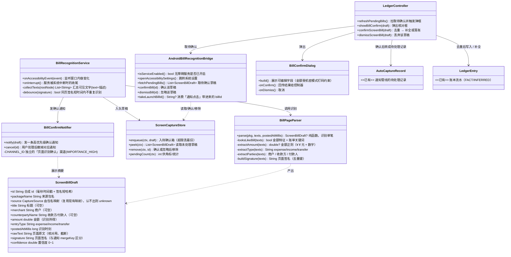

# 页面识别自动记账 设计文档

> 状态：**已实现**（见文末「实施记录」；实现过程中与草稿的差异都记在那里）
> 一句话：用户在任意 App 打开「支付 / 账单详情页」时，由无障碍服务读取页面文字，识别出**单笔**交易，弹框让用户核对，确认后落账；与已有账目重复时只补全缺失信息，不重复记账。

---

## 1. 背景与目标

现状：自动记账**只靠通知**（`LedgerNotificationListenerService.kt`）。不少 App 或场景不发通知，或通知里没有可解析的金额/方向，导致漏单。

目标：增加**第二条输入源**——页面识别。用户在账单页停留时自动抓取，作为通知漏单的补充。

**明确的边界**：页面识别是「补漏」，不是替代通知。通知仍是第一优先来源（见 §9.3 冲突优先级）。

---

## 2. 已确认需求（来自对话）

| 编号 | 需求 | 结论 |
| --- | --- | --- |
| 1 | 识别范围 | 一次**一笔**；不限微信/支付宝，其他 App 也要 |
| 2 | 技术路线 | **读控件节点**（`node.text` / `contentDescription`），不用剪贴板 |
| 3 | 落账方式 | 先**待确认**，当场弹框让用户核对后才落账 |
| 4 | 去重 | 先判断是否与已有账目重复；重复且缺信息则**补全** |
| 5 | 分发 | 自用（侧载），可接受无障碍权限 |
| 6 | 弹框方式 | **高优先级通知**「识别到一笔，点开确认」→ 点开进 App 弹核对框（方案 b） |

---

## 3. 方案总览

```
用户在任意 App 打开账单详情页
        │  (TYPE_WINDOW_CONTENT_CHANGED / STATE_CHANGED)
        ▼
BillRecognitionService（无障碍服务，只做三件事：取文字、识别、入队）
        │  同页防抖，避免反复识别
        ▼
BillPageParser（纯函数，Kotlin 单测覆盖）
        │  特征检测（金额 + 账单关键词）→ 提取字段 → 置信度
        ▼
ScreenCaptureStore（待确认箱，SharedPreferences，≤ N 条，按签名去重）
        │  识别成功
        ▼
BillConfirmNotifier（高优先级通知：「识别到一笔 ¥xx，点开确认」）
        │  用户点击
        ▼
MainActivity 携带 billId 启动 → Flutter 侧
        ▼
BillConfirmDialog（可编辑的核对框）
        │  用户确认
        ▼
确认后处理：先查重（金额+时间+商户）→
    ├─ 命中已有账目 → 只补全缺失的**推测字段**（标题/商户/分类/备注）
    └─ 未命中        → 复用现有单条处理路径（缓存/模板/千问）落账
```

**核心原则（沿用本项目既有铁律）**：
- 无障碍服务**永不**调模型、永不写账本，只「取文字 + 入队」；
- 页面识别的结果**不直接进账本**，必须经用户确认框；
- 落账复用现有去重/合并/冲突优先级与 FACT / INFERRED 规则。

---

## 4. 类图



---

## 5. 组件职责

### 5.1 Kotlin 侧（`android/app/src/main/kotlin/com/aline/jier/jier/`）

| 组件 | 职责 | 不做什么 |
| --- | --- | --- |
| `BillRecognitionService` | 无障碍服务；收事件、汇总可见文字、防抖、调用解析、入队、发通知 | 不调模型、不写账本、不做网络 |
| `BillPageParser` | 纯函数识别：特征检测 + 字段提取 + 置信度；可被 JVM 单测 | 不碰 Android 上下文 |
| `ScreenCaptureStore` | 待确认箱持久化（SharedPreferences，镜像 `AutoCaptureStore` 的写法） | 不做识别 |
| `BillConfirmNotifier` | 高优先级通知的创建/撤销，`PendingIntent` 带 `billId` 打开 `MainActivity` | — |

### 5.2 Dart 侧（`lib/src/`，作为 `app.dart` 的 `part`）

| 组件 | 职责 |
| --- | --- |
| `AndroidBillRecognitionBridge` | 新的 `MethodChannel` 桥（仿 `AndroidAutoCaptureBridge` `app.dart:2386`） |
| `BillConfirmDialog` | 核对框 UI（新增页面文件，如 `bill_confirm.dart`） |
| `LedgerController` 新方法 | 拉取待确认、弹框、确认后去重/补全/落账 |

---

## 6. 数据模型改动

**尽量不改现有模型**，优先复用：

- `ScreenBillDraft`（新增，Kotlin + Dart 各一份）：见 §4。
- `LedgerCapture` / `AutoCaptureRecord`：**不改字段**。确认后把草稿转成一条 `AutoCaptureRecord` 走现有处理路径；页面识别来源用 `scenario = "screenBill"` + 一个 `页面识别` 标签标识。
- `CaptureSource`（`app.dart:2673`）：**不新增枚举值**，继续按包名映射（微信/支付宝/淘宝…）；认不出的 App 用 `unknown`。这样各来源开关、统计都不用动。
- `LedgerEntry`：**不改字段**。补全时只写 INFERRED 字段（`inferredFields` 已存在，`docs/04 §2.1`）。

> 若评审时你希望页面识别在界面上能单独筛选，再考虑给 `LedgerEntry` 加 `origin` 字段；v1 先用标签，避免序列化改动与兼容测试。

---

## 7. 关键流程

### 7.1 识别（Kotlin，纯函数）

```
1. 收集可见文字：遍历节点树取 text + contentDescription，去空、去重
2. 特征检测 looksLikeBill：必须同时满足
   - 出现金额：¥/￥/CNY/人民币/元 后面的数字
   - 出现账单关键词：交易/账单/订单/收款/付款/消费/金额/商户/收款方/转账…
3. 字段提取：
   - amount：金额正则（唯一权威，与通知解析同款思路）
   - entryType：付款/消费/扣款→支出；收款/入账/到账→收入；转账→transfer
   - merchant / counterparty：带标签的字段（商户/收款方/付款人/对方/店铺）取相邻文本
   - title：商户 + 用途线索（可空）
4. 置信度：金额命中 + 关键词命中 + 标签字段命中 → 累加
5. 产出 ScreenBillDraft
```

**限制（必须在实现里体现）**：WebView / 自绘（Flutter、Unity、Canvas）页面暴露的节点少或为乱码 → 识别会失败。此情况**优雅降级**：不入队、不弹框，用户可手动记账。

### 7.2 去重（识别阶段）

- 页面签名 `signature` = 包名 + 归一化文字（数字挖成 `#`）+ 截断。同一页反复打开不重复入队。
- 入队时按 `signature` 判重：已存在且未处理的同签名草稿，直接丢弃新的一条。

### 7.3 通知与弹框

- 识别成功且**置信度 ≥ 阈值**（建议 0.5）→ `BillConfirmNotifier.notify(draft)`：高优先级渠道（可横幅），文案如
  `识别到一笔 ¥38.00 · 淘宝，点开确认`，`PendingIntent` 带 `billId` 打开 `MainActivity`。
- 置信度 < 阈值：**只入待确认箱、不发通知**，用户下次打开 App 才看到（减少打扰，避免误识别频繁弹）。
- `MainActivity` 在 `onNewIntent` 里把 `billId` 交给 Flutter（新增桥方法 `takeLaunchBillId`）。
- Flutter 侧：启动或回前台时 `refreshPendingBills()`，有草稿就 `showBillConfirm(draft)`。
- 用户没点通知：草稿留在 `ScreenCaptureStore`，下次打开 App 仍会弹（有上限、有「忽略」入口）。

### 7.4 确认后的处理（去重 + 补全）

```
confirmScreenBill(draft):
  1. 与账本已有流水比对：**去账本里找"一样的"**——
     判据 = 金额一致 + **交易时间接近（±5 分钟）** + 商户 / 对象 / 合并键吻合。
     交易时间从页面读（`[screenBillToEntry]` 已把页面交易时间写进 `occurredAt`）。
  2. 命中唯一一条已有账目：
       - amount/type/occurredAt（事实字段）不动
       - 只补全空的 INFERRED 字段：title / merchant / categoryId / note
       - 结果提示：「已和已有账目合并，补全了商户与分类」
  3. 未命中：
       - 转成 AutoCaptureRecord，**立即**复用现有单条处理路径：
         商户缓存 → 模板 → 千问分类（与通知管线同一套），不等 20 秒轮询
       - 落账；分类不确定时保留「待确认」标签
  4. 完成后 ScreenCaptureStore.remove(id) + BillConfirmNotifier.cancel(id)
```

---

## 8. 权限与清单改动

`AndroidManifest.xml` 新增：

```xml
<service
    android:name=".BillRecognitionService"
    android:exported="false"
    android:label="潮汐账本页面识别"
    android:permission="android.permission.BIND_ACCESSIBILITY_SERVICE">
    <intent-filter>
        <action android:name="android.accessibilityservice.AccessibilityService" />
    </intent-filter>
    <meta-data
        android:name="android.accessibilityservice"
        android:resource="@xml/accessibility_service_config" />
</service>
```

新增 `res/xml/accessibility_service_config.xml`：
- `canRetrieveWindowContent="true"`
- `accessibilityEventTypes`：`typeWindowContentChanged|typeWindowStateChanged`
- `accessibilityFeedbackType="feedbackGeneric"`
- **不**申请 `flagRetrieveInteractiveWindows` 之外的多余能力；不主动点击、不模拟输入。

其它：
- `POST_NOTIFICATIONS` 已声明（`AndroidManifest.xml:13`），无需新增。
- 高优先级通知渠道在运行时创建（Android 8+）。
- 无障碍权限需用户手动开启：新增桥方法 `isServiceEnabled` / `openAccessibilitySettings`，并在设置页给入口（复用通知权限那套引导文案）。

---

## 9. 与现有系统的复用与边界

### 9.1 复用

- 入队模式镜像 `AutoCaptureStore.kt`（持久化、上限、丢最旧计数）。
- 桥模式镜像 `AndroidAutoCaptureBridge`（`app.dart:2386`）+ `MainActivity.kt:106` 的方法分发。
- 去重/合并复用 `captureCorrelationScore`（`app.dart:206`）、`captureAutoMergeThreshold`（`app.dart:262`）、`captureWindowMs`（`app.dart:93`）。
- 分类复用商户缓存 / 模板 / 千问（`_syncAutoCapturedEntries`，`app.dart:1285`）。
- 事实/推测分离复用 `inferredFields`（`docs/04 §2.1`）+「待确认」标签 `_needsReviewTag`（`app.dart:58`）。

### 9.2 新增

- 一条独立输入源（页面识别）与独立待确认箱；独立通知渠道。

### 9.3 冲突优先级（页面识别 vs 通知，待你确认）

建议：**同一笔的字段，通知来源优先于页面识别**。因为通知是 App 官方结构化输出，页面文字更易误读。
- 若先有页面识别草稿、后又来通知：通知处理时按现有合并逻辑找到该账目，覆盖/补全；
- 若先有通知账目、后又页面识别：确认框命中已有账目 → 只补全缺失项（不覆盖）。

---

## 10. 风险与取舍（评审要点）

| # | 风险 | 取舍 / 缓解 |
| --- | --- | --- |
| 1 | **WebView / 自绘页面读不到节点** | 通用识别在这些页必然失败；v1 接受，优雅降级并提示手动记。不引入 OCR（另一个权限 + 复杂度） |
| 2 | **字段归因靠启发式，可能误读** | 置信度阈值 + **必须经确认框**才落账；默认不自动写 |
| 3 | **无障碍权限敏感** | 自用侧载可接受；服务只读窗口文字、不模拟操作；README/隐私页如实说明 |
| 4 | **全 App 事件频繁 → 耗电 / 读到无关隐私** | 只在「金额 + 账单关键词」同时命中时才处理；同页签名防抖；其余一律忽略 |
| 5 | **同一笔既通知又页面识别 → 重复** | §7.4 去重；冲突优先级 §9.3 |
| 6 | **通知点开才弹框，用户不点就漏确认** | 草稿持久化，下次打开 App 仍会弹 |
| 7 | **无障碍服务独立于 App 进程** | 识别可在 App 未打开时发生，但落账需回到 App 确认（本设计如此） |

---

## 11. 设计决策（已锁定）

| # | 决策 |
| --- | --- |
| 1 | 确认后**立即**用现有单条路径落账，不等 20 秒轮询 |
| 2 | 低置信度草稿**只留在 App 内**待确认列表、**不发通知**（阈值 `confidence < 0.5`） |
| 3 | 冲突优先级：同一笔字段 **通知 > 页面识别** |
| 4 | 待确认箱上限 **30 条**、保留 **7 天** |
| 5 | v1 **不加 `origin` 字段**，页面识别来源只用「页面识别」标签标识 |
| 6 | 无障碍入口放在设置页「自动记账」卡片内，新增一行「页面识别（无障碍）」 |

---

## 12. 测试计划

**Kotlin 单测（`android/app/src/test`，仿现有 `NotificationParserTest`）**
- `BillPageParser`：典型账单页文字 → 正确识别金额/方向/商户；无关页（聊天、设置）→ null；金额夹在中间；多金额取主金额。

**Dart 单测（`test/ledger_book_test.dart` 追加）**
- 草稿 → `AutoCaptureRecord` 转换正确；
- 去重命中：金额+时间吻合 → 只补全推测字段、事实字段不动；
- 去重未命中：正常落一笔；
- `ScreenBillDraft` 序列化往返不丢字段。

---

## 13. 实施步骤（获批后）

1. Kotlin：`ScreenBillDraft` + `ScreenCaptureStore` + `BillPageParser` + 单测；
2. Kotlin：`BillRecognitionService` + `accessibility_service_config.xml` + 清单；
3. Kotlin：`BillConfirmNotifier` + `MainActivity` 方法分发 + `billId` 透传；
4. Dart：`AndroidBillRecognitionBridge`；
5. Dart：`BillConfirmDialog` + `LedgerController.confirmScreenBill`（去重/补全）；
6. 设置页入口 + 权限引导；
7. 文档：`docs/` 增补一节 + README 功能说明。

---

## 14. v1 明确不做

- 不做截屏 OCR（不申请 `MediaProjection`）；
- 不做悬浮窗确认框（用通知，见需求 6）；
- 不做列表页一屏多笔（只做单笔详情页）；
- 不做自动点击「复制/展开」等页面操作；
- 不做跨词义的神经网络检索/识别。

---

## 15. 实施记录（实际构建）

### 15.1 落地的文件

| 侧 | 文件 | 说明 |
| --- | --- | --- |
| Kotlin | `BillPageParser.kt` | 纯函数识别；`NotificationParser.detectSource` 由 private 放宽为 internal 以复用包名映射 |
| Kotlin | `ScreenBillDraft.kt` | 草稿模型，`toMap()` 键与 `AutoCaptureRecord` 对齐（`rawBody` = 页面原文） |
| Kotlin | `ScreenCaptureStore.kt` | 待确认箱：上限 30、保留 7 天、按签名去重 |
| Kotlin | `BillRecognitionService.kt` | 无障碍服务：700ms 节流、单页 ≤800 节点、置信度 ≥0.5 才发通知 |
| Kotlin | `BillConfirmNotifier.kt` | 高优先级通知渠道，`PendingIntent` 带 `bill_id` |
| Kotlin | `MainActivity.kt` | 新增 `bill_recognition` 通道与 `billId` 透传（`onCreate`/`onNewIntent`） |
| Kotlin | `res/xml/accessibility_service_config.xml`、`res/values/strings.xml`、`AndroidManifest.xml` | 服务声明与文案 |
| Dart | `local_screen_bill.dart` | 确认框 + `screenBillToEntry` / `findScreenBillDuplicate` / `fillMissingFromScreenBill` / `suggestScreenBillCategoryId` |
| Dart | `app.dart` | `AndroidBillRecognitionBridge`、`LedgerViewState.pendingScreenBills`、`refreshPendingBills` / `dismissScreenBill` / `confirmScreenBill`、根页面弹框调度 |
| Dart | `local_capture.dart` | 设置页「页面识别（无障碍）」入口 |
| 测试 | `BillPageParserTest.kt`、`test/ledger_book_test.dart` | 见 §12 |

### 15.2 与草稿的差异

1. **确认即落账用确定性路径，不调用模型**。草稿 §7.4 说「复用缓存/模板/千问」；实现里分类直接取用户在确认框里的选择（预填建议来自商户缓存/模板/默认），标题由商户生成 —— 更快、且模型没装也能确认。商户缓存/模板仍用于**预填建议**。
2. **补全只针对 `autoCaptured` 的已有账目**，不碰手动记账的条目，避免误并。
3. **解析账单页交易时间并据此判重**：`BillPageParser` 从页面读交易时间（含年月日 / 月日 / 今天·昨天 + 时分），
   写进落账的发生时间；`ScreenBillDraft` 把**识别时刻**与**交易时间**分开存（`capturedAtMillis` vs `postedAtMillis`），
   草稿保留期按识别时刻算。判重 = 金额一致 + 交易时间 ±5 分钟 + 商户/对象/合并键吻合 ——
   这样「同商户同金额」的两次消费（时间差得远）不会被并成一笔。
4. **`_isCrossPaymentPair`、`screenBillToEntry` 等辅助函数**放在 `local_screen_bill.dart`（part of `app.dart`），并把三个辅助函数设为**库内可见的非私有**，以便 Dart 单测覆盖。

### 15.3 未验证项（重要）

- 本次实现**未在本机运行 `flutter analyze` / `flutter test` / Gradle / 真机**：该环境未安装 Flutter SDK（`flutter`、`dart` 均不在 PATH）。合入前请在有 SDK 的机器上跑：
  ```bash
  flutter pub get
  flutter analyze
  flutter test
  cd android; ./gradlew test        # Kotlin 单测 + 编译
  flutter build apk --release
  ```
- 无障碍服务需真机验证：开启服务 → 打开一个原生账单页 → 看通知与确认框。

